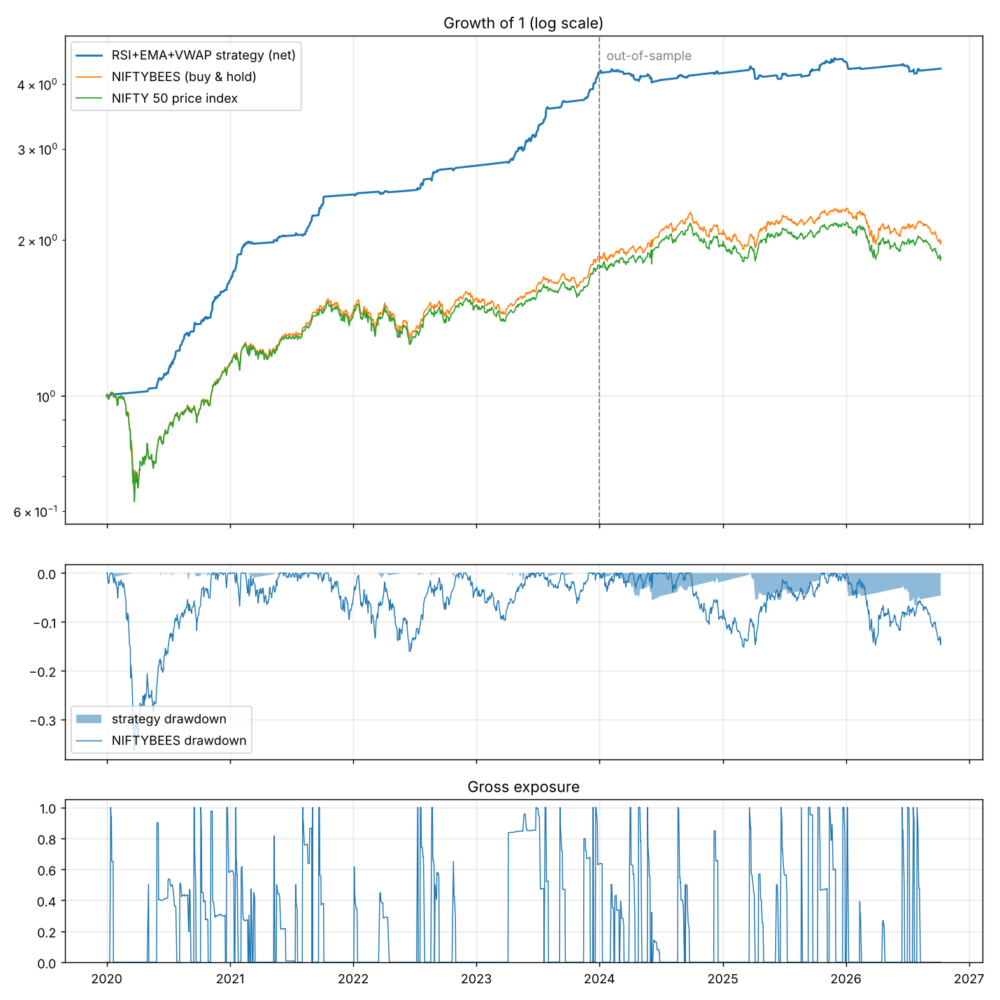
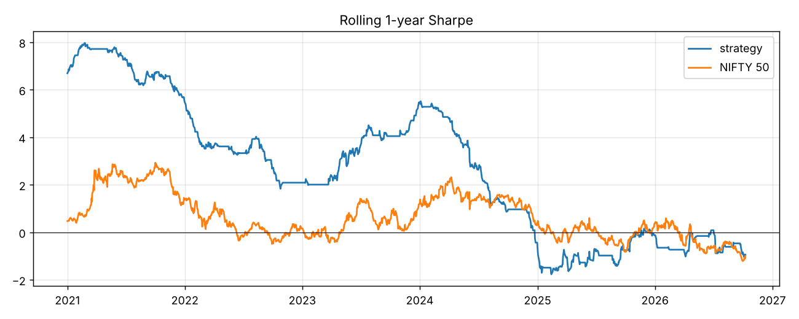
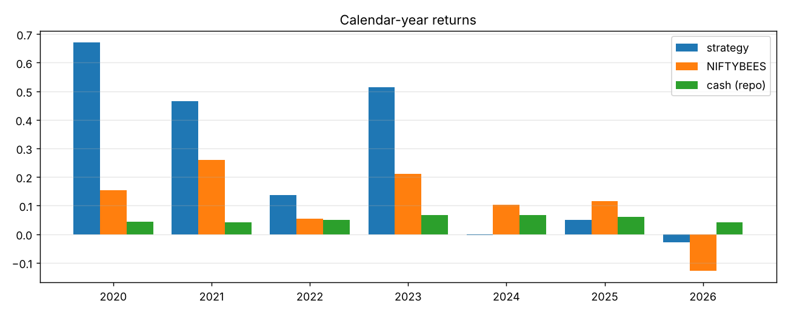
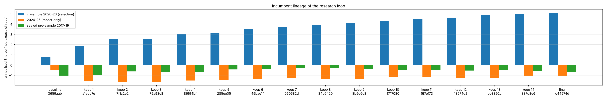

# RSI + EMA + VWAP on the Nifty 50: the v2 strategy (protocol v4)

The question: which changes make 2024-2026 positive as well, and the strategy effective over the whole of 2020-2026? Protocol v4 researched on every window seen so far at once (2017-04..2019-12, 2020-2023, 2024-01..2026-10) and maximised the worst of the three window Sharpes, with keep gates against regime trading, best-day dependence, single years and parameter peaks, and a brief-compliance requirement for the final strategy. A new hold-out, 2011-04-01..2016-05-31, was built before round 1 and scored once at the end. 3,559 rows are logged in `results_v4.tsv`; the protocol, every amendment and every merge are in `program.md`; the research note is RCG-RN-REV-002 (`make_pdf_v4.py`).

## Headline

Sharpe ratio of daily returns over the RBI repo rate, net of 15 bps one-way costs, next-open execution.

| | 2017-19 | 2020-23 | 2024-26 | 2017-26 | 2020-26 | worst window | deep hold-out 2011-16 |
|---|---|---|---|---|---|---|---|
| **v2 strategy** (`strategy.py`) | 0.788671 | 1.121151 | 0.846691 | 0.956445 | 1.017929 | 0.788671 | 0.682866 |
| v1 strategy (`v4/v1_final.py`) | -0.724323 | 4.971897 | -1.063191 | 1.816648 | 2.77733 | -1.063191 | -0.088347 |
| EMA timer R0 (`v4/r0_ema_timer.py`) | 0.746666 | 1.12423 | 0.199464 | 0.79065 | 0.807696 | 0.199464 | -0.277448 |
| NIFTYBEES buy and hold | 0.548408 | 0.689159 | -0.219142 | 0.424703 | 0.392177 | -0.219142 | - |
| NIFTY 50 price index | 0.415402 | 0.584933 | -0.280989 | 0.325621 | 0.305365 | -0.280989 | 0.012379 |

The v2 strategy: CAGR 12.3% over 2017-2026 (repo rate included), maximum drawdown -6.6%, average exposure 16%, turnover 13.1x a year; it beat cash in 8 of 10 calendar years, was level with it in 2018 and trailed it in 2026 (2017 from April, 2026 to October).

## The v2 strategy

```
Pullback strategy: RSI + EMA + VWAP dip buying inside uptrends (protocol v4.2, incumbent 1, merged after round 3).
The final strategy of protocol v4: rounds 4 and 5 merged nothing, so under the stopping rule incumbent 1 is final.
Its code is identical to v4/inc1_pullback.py, the file scored on the deep hold-out; this copy's docstring was
corrected after that look (program.md, review of the v2 deliverables).

The whole book is a dip-buying sleeve. Its trades open only when the leaders of the market have pulled back together
inside a long uptrend, and close when the dip has been bought back. Every weight is decided with data up to the
close of day t; the harness trades it at the open of t+1. Capital not in a trade stays in cash and earns the repo
rate (credited by the harness).

RULES
1. Trigger (EMA + VWAP). Trades open only on a day when
     a) the NIFTY 50 closes above its EMA(trend_n = 100): the market is in a long uptrend, and
     b) the pullback is broad among the leaders: of the members in their own uptrend (close above their own
        EMA(100)), more than breadth_cut (60 %) close below their rolling vwap_n (10)-day VWAP.
2. Name filter (EMA + RSI). On such a day a member is eligible when it is in its own uptrend (close above its
   EMA(100)) and was sold hard: Wilder RSI(rsi_n = 3) below rsi_max = 20.
3. Selection (VWAP). Free slots (slots = 12; one slot = 1/12 of the book) are filled with the eligible names that
   sit deepest below their 10-day VWAP. A held name's target stays 1/12 until it is sold; the harness trades the
   drifted position back to 1/12 at every open (costs included), so positions do not drift.
4. Exit (VWAP + time). A held name is sold as soon as it closes back above its 10-day VWAP (the dip has been
   bought back), or after max_hold (20) sessions if that never happens. Names leaving the index are sold by the
   harness.

WHY IT SHOULD HOLD ACROSS REGIMES
* It harvests short-term reversal after market-wide selling: forced and impatient sellers push uptrending names
  below the volume-weighted price their recent buyers paid, and the bounce back to that price pays whoever supplies
  liquidity. Any member in its own uptrend can qualify, whatever its sector, so a change of market leadership
  changes the names rather than the trade (the depth ranking only decides which names fill the slots when more
  qualify than are free; the audits found it no better than random).
* Breadth is counted over the uptrend names only, so it fires when the leaders themselves pull back, not in narrow
  tapes where most members are already falling. The index filter keeps it out of crashes in progress (March 2020);
  the time stop cuts dips that are not bought back within a month.

PROVENANCE (results_v4.tsv, program.md protocol v4.2)
Round 1 (pullback lens) found the dip-buying effect with an index RSI(3) trigger (objective 0.69, fragile). Round 2
moved the oversold test to the stocks and the trigger to leader breadth, inside a 20 % EMA-timer core (0.75).
Round 3 removed a dead entry rule, a token equal-weight sliver and the breadth size ramp (0.745). The round-3 audits
then showed that the 20 % EMA-timer core LOWERS the objective (removing it: 0.79) while every gate against R0 still passes, so
under the simplification rule the lead deleted it (and one dead sell rule duplicated by the harness) for this
incumbent.

DISCLOSED WEAK POINTS (round-3 audits; figures re-measured on this book after the deep look, program.md)
* Low exposure: 16 % of the book on average over 2017-26, stocks held on about a third of sessions. The CAGR
  includes the repo rate earned on idle capital; the Sharpe, measured over the repo rate, does not.
* Event days: a dip buyer earns much of its return on a few market-wide rebound days. With each window's own 5 best
  days removed, 2017-19 and 2020-23 fall below the plain EMA timer R0; the 2024-26 advantage survives.
* The 2024-26 result is concentrated in 2024 (the June 2024 exit-poll rebound among its best days); 2026 is negative.
* The VWAP-depth ranking is no better than random choice among eligible names (it is kept because some rule must
  choose and it is the structural one). Switching the RSI(3) filter off raises 2024-26 (0.85 to 1.06)
  but lowers 2017-19 (0.79 to 0.65) and 2020-23 (1.12 to 0.71): removing it costs 0.14 of objective. It also
  carries the brief's RSI.
* vwap_n is one length shared by the trigger, the ranking and the exit; untied, the trigger's own length is a
  narrow peak (8 or 12 sessions keeps only 45 % or 57 % of the margin over R0, below the plateau gate's 60 %).

Long-only, gross at most 1 (12 slots of 1/12). Longest lookback 100 sessions (EMA100), inside the 200-session limit;
warm-up NaNs read as "no trend", "not oversold", "no breadth".

Brief-compliance switches (not parameters): use_ema=False makes every EMA rule pass (index and stock trend filters
off, breadth over all live members); use_rsi=False drops the stock RSI filter; use_vwap=False drops the breadth
trigger (trades may open every day), the VWAP-depth ranking (ties keep the ticker order) and the VWAP-reclaim exit
(time stop only).
```

Parameters: `{"trend_n": 100, "breadth_cut": 0.6, "rsi_n": 3, "rsi_max": 20.0, "vwap_n": 10, "max_hold": 20, "slots": 12, "use_rsi": true, "use_ema": true, "use_vwap": true}`

## Every protocol-v4 strategy on every seen window

| strategy | objective | 2017-19 | 2020-23 | 2024-26 | 2017-26 | 2020-26 | drop-10 | +years | turnover | exposure | objective at 25 bps |
|---|---|---|---|---|---|---|---|---|---|---|---|
| `v4/v1_baseline.py` | -1.0781 | -1.0781 | 0.7788 | -0.4908 | -0.0536 | 0.3085 | -0.3637 | 4 | 37.54 | 0.7968 | -1.4483 |
| `v4/v1_final.py` | -1.0632 | -0.7243 | 4.9719 | -1.0632 | 1.8166 | 2.7773 | 1.5532 | 5 | 15.36 | 0.207 | -1.3773 |
| `v4/r0_ema_timer.py` | 0.1995 | 0.7467 | 1.1242 | 0.1995 | 0.7906 | 0.8077 | 0.5137 | 8 | 3.33 | 0.7061 | 0.1675 |
| `v4/r1_overlay.py` | 0.5763 | 0.6650 | 0.5763 | 0.6256 | 0.6108 | 0.5913 | 0.2703 | 7 | 8.52 | 0.4357 | 0.4662 |
| `v4/r1_pullback.py` | 0.6873 | 0.6895 | 0.6873 | 0.8115 | 0.7153 | 0.7279 | 0.2780 | 7 | 13.5 | 0.1647 | 0.4600 |
| `v4/r1_relstrength.py` | 0.2902 | 0.2902 | 1.0139 | 0.3559 | 0.6255 | 0.7734 | 0.3309 | 7 | 8.31 | 0.7054 | 0.2142 |
| `v4/r1_repair.py` | 0.2532 | 0.2532 | 1.2120 | 0.2621 | 0.7049 | 0.8656 | 0.4379 | 6 | 6.13 | 0.7061 | 0.1812 |
| `v4/r1_timing.py` | 0.2883 | 0.3092 | 0.9182 | 0.2883 | 0.5908 | 0.6938 | 0.2842 | 7 | 11.33 | 0.6573 | 0.1858 |
| `v4/r1_trendbasket.py` | 0.3129 | 0.4404 | 0.9182 | 0.3129 | 0.6268 | 0.6997 | 0.3557 | 7 | 8.37 | 0.6258 | 0.2387 |
| `v4/r2_breadth.py` | 0.3718 | 0.7807 | 1.3210 | 0.3718 | 0.9299 | 0.9847 | 0.6514 | 9 | 5.17 | 0.8049 | 0.3262 |
| `v4/r2_confirm.py` | 0.3507 | 0.8218 | 1.1698 | 0.3507 | 0.8649 | 0.8817 | 0.5809 | 9 | 10.55 | 0.7181 | 0.2591 |
| `v4/r2_pullbackcombo.py` | 0.7528 | 0.7756 | 1.1051 | 0.7528 | 0.9222 | 0.9761 | 0.5499 | 9 | 9.67 | 0.2555 | 0.5673 |
| `v4/r2_sleeve.py` | 0.3646 | 0.8243 | 1.0709 | 0.3646 | 0.8217 | 0.8219 | 0.5540 | 8 | 6.73 | 0.7054 | 0.2895 |
| `v4/r2_whipsaw.py` | 0.4528 | 0.7097 | 1.0925 | 0.4528 | 0.8279 | 0.8712 | 0.5513 | 8 | 5.93 | 0.6759 | 0.3991 |
| `v4/r3_clean.py` | 0.7452 | 0.8938 | 1.2326 | 0.7452 | 1.0107 | 1.0581 | 0.6298 | 9 | 11.27 | 0.2723 | 0.5593 |
| `v4/r3_combine.py` | 0.7556 | 0.8659 | 1.0928 | 0.7556 | 0.9364 | 0.9691 | 0.5627 | 9 | 9.6 | 0.2555 | 0.5695 |
| `v4/r3_core.py` | 0.7452 | 0.8938 | 1.2326 | 0.7452 | 1.0107 | 1.0581 | 0.6298 | 9 | 11.27 | 0.2723 | 0.5593 |
| `v4/r4_event.py` | 0.9101 | 1.1628 | 1.0392 | 0.9101 | 1.0179 | 0.9835 | 0.6418 | 9 | 11.28 | 0.141 | 0.6859 |
| `v4/r4_exits.py` | 0.9872 | 1.1902 | 1.0664 | 0.9872 | 1.0399 | 1.0234 | 0.6414 | 9 | 13.71 | 0.1324 | 0.7282 |
| `v4/r4_sizing.py` | 0.8429 | 0.9341 | 1.1419 | 0.8429 | 0.9972 | 1.0302 | 0.5978 | 8 | 13.82 | 0.173 | 0.6377 |
| `v4/r5_reconcile.py` | 0.9339 | 1.1747 | 1.0978 | 0.9339 | 1.0381 | 1.0282 | 0.6470 | 9 | 13.61 | 0.1511 | 0.6893 |
| `v4/r5_simplify.py` | 0.7915 | 0.8564 | 1.0886 | 0.7915 | 0.9394 | 0.9783 | 0.5381 | 8 | 13.18 | 0.1475 | 0.5666 |
| `v4/r5_trigger.py` | 0.8467 | 0.8495 | 1.1212 | 0.8467 | 0.9691 | 1.0179 | 0.5729 | 8 | 13.02 | 0.1632 | 0.6200 |
| `v4/inc1_pullback.py` | 0.7887 | 0.7887 | 1.1212 | 0.8467 | 0.9564 | 1.0179 | 0.5590 | 9 | 13.07 | 0.1639 | 0.5571 |
| `strategy.py` | 0.7887 | 0.7887 | 1.1212 | 0.8467 | 0.9564 | 1.0179 | 0.5590 | 9 | 13.07 | 0.1639 | 0.5571 |

## Deep hold-out, scored once

| strategy | role | Sharpe | CAGR | max DD | exposure | NIFTY Sharpe | 2011 | 2012 | 2013 | 2014 | 2015 | 2016 |
|---|---|---|---|---|---|---|---|---|---|---|---|---|
| `v4/v1_baseline.py` | information | -0.6063 | -0.0081 | -0.2389 | 0.6546 | 0.0124 | -2.227 | -1.0828 | -0.7496 | 1.3503 | -1.5051 | -0.5907 |
| `v4/v1_final.py` | information | -0.0883 | 0.0744 | -0.0524 | 0.1819 | 0.0124 | -1.067 | -0.3502 | -0.2502 | 1.6146 | -1.8713 | 0.3776 |
| `v4/r0_ema_timer.py` | information | -0.2774 | 0.042 | -0.173 | 0.612 | 0.0124 | -3.4737 | 0.7345 | -0.7025 | 1.4534 | -1.6072 | 0.9946 |
| `v4/r1_timing.py` | information | -0.5346 | 0.0144 | -0.1693 | 0.5737 | 0.0124 | -3.1742 | 0.608 | -0.8788 | 0.9169 | -1.7337 | 0.4985 |
| `v4/r1_trendbasket.py` | information | -0.2159 | 0.052 | -0.1706 | 0.5021 | 0.0124 | -2.7488 | 0.2258 | -1.2778 | 1.386 | -1.4689 | 1.0065 |
| `v4/r1_relstrength.py` | information | -0.4382 | 0.0179 | -0.2633 | 0.6114 | 0.0124 | -2.7342 | 0.9016 | -1.1552 | 1.897 | -2.4715 | 0.1002 |
| `v4/r1_pullback.py` | information | 0.4351 | 0.1156 | -0.0664 | 0.1732 | 0.0124 | -0.5223 | 1.2897 | -0.0991 | 0.5838 | 0.4307 | 1.1096 |
| `v4/r1_repair.py` | information | -0.3402 | 0.0323 | -0.1825 | 0.612 | 0.0124 | -3.5705 | 0.7377 | -1.0336 | 1.317 | -1.7844 | 1.4137 |
| `v4/r1_overlay.py` | information | -0.2252 | 0.0546 | -0.1646 | 0.3817 | 0.0124 | -2.3174 | 0.245 | -0.8688 | 1.0696 | -1.2164 | 1.2088 |
| `v4/r3_clean.py` | information | 0.4665 | 0.1167 | -0.0473 | 0.2528 | 0.0124 | -1.8593 | 0.8119 | -0.2426 | 1.1044 | 0.1276 | 1.7767 |
| `v4/inc1_pullback.py` | incumbent/final | 0.6829 | 0.1353 | -0.0496 | 0.163 | 0.0124 | 1.3727 | 0.7529 | -0.0176 | 0.8893 | 0.9781 | 1.9182 |

Data checks: 1,268 sessions scored, 47 to 49 members with bars on any day; the look log is `reports/deep_holdout_log.tsv`.

Sampling error (stationary bootstrap, mean block 20 sessions, 20000 paired paths): the final's Sharpe 0.68 has a 95 % interval of 0.10 to 1.27; its lead over R0 0.13 to 1.82; over the NIFTY 50 -0.17 to 1.53 (not established). Daily t-statistic 1.53, monthly 2.08: the strategy's days are negatively autocorrelated (variance ratio of 20-day sums 0.43).

## Validation of the v2 strategy

Strategy: `strategy.py`; params `{"trend_n": 100, "breadth_cut": 0.6, "rsi_n": 3, "rsi_max": 20.0, "vwap_n": 10, "max_hold": 20, "slots": 12, "use_rsi": true, "use_ema": true, "use_vwap": true}`

Lookahead check: ok=True, max diff 0.0, 33/91 informative

### Windows (Sharpe of daily excess over the repo rate, net of 15 bps)

| | 2017-19 | 2020-23 | 2024-26 | 2017-26 | 2020-26 |
|---|---|---|---|---|---|
| strategy | 0.7887 | 1.1212 | 0.8467 | 0.9564 | 1.0179 |
| niftybees | 0.5484 | 0.6892 | -0.2191 | 0.4247 | 0.3922 |
| nifty50 | 0.4154 | 0.5849 | -0.2810 | 0.3256 | 0.3054 |
| r0_ema_timer | 0.7467 | 1.1242 | 0.1995 | 0.7906 | 0.8077 |

Objective (worst window) 0.7887; span CAGR 0.1226, max DD -0.0662, vol 0.0641, turnover 13.07x/yr, exposure 0.1639, names 5.65; span Sharpe without the 10 best days 0.5590; 9/10 years with a positive sum of daily excess returns (the consistency gate's count; compounded, 8 beat cash, 1 were level with it).

### Costs

| bps | objective | 2017-19 | 2020-23 | 2024-26 | 2017-26 | 2020-26 | CAGR 2017-26 | max DD |
|---|---|---|---|---|---|---|---|---|
| 0 | 1.1328 | 1.1328 | 1.4112 | 1.1661 | 1.2589 | 1.3142 | 0.1448 | -0.0640 |
| 10 | 0.9040 | 0.9040 | 1.2184 | 0.9536 | 1.0578 | 1.1172 | 0.1299 | -0.0655 |
| 15 | 0.7887 | 0.7887 | 1.1212 | 0.8467 | 0.9564 | 1.0179 | 0.1226 | -0.0662 |
| 25 | 0.5571 | 0.5571 | 0.9253 | 0.6320 | 0.7525 | 0.8181 | 0.1080 | -0.0678 |
| 40 | 0.2093 | 0.2093 | 0.6292 | 0.3097 | 0.4450 | 0.5165 | 0.0865 | -0.0701 |

### Calendar years

| year | return | Sharpe | max DD | exposure | NIFTY ret | NIFTY Sharpe | NIFTYBEES ret | cash |
|---|---|---|---|---|---|---|---|---|
| 2017 | 0.1150 | 1.4476 | -0.0236 | 0.2459 | 0.1479 | 1.4518 | 0.1558 | 0.0468 |
| 2018 | 0.0641 | 0.0026 | -0.0416 | 0.068 | 0.0315 | -0.1896 | 0.0482 | 0.0648 |
| 2019 | 0.0952 | 0.8717 | -0.0248 | 0.1424 | 0.1202 | 0.4862 | 0.1361 | 0.0591 |
| 2020 | 0.2180 | 2.4716 | -0.0358 | 0.1175 | 0.1490 | 0.4649 | 0.1542 | 0.0444 |
| 2021 | 0.1084 | 0.6016 | -0.0662 | 0.3327 | 0.2412 | 1.2223 | 0.2597 | 0.0408 |
| 2022 | 0.1124 | 0.8908 | -0.0331 | 0.1292 | 0.0433 | 0.0483 | 0.0546 | 0.0501 |
| 2023 | 0.1275 | 1.5559 | -0.0145 | 0.1633 | 0.2003 | 1.2955 | 0.2101 | 0.0667 |
| 2024 | 0.1708 | 1.1283 | -0.0570 | 0.2629 | 0.0880 | 0.2081 | 0.1036 | 0.0677 |
| 2025 | 0.1049 | 1.5015 | -0.0143 | 0.1005 | 0.1051 | 0.4217 | 0.1166 | 0.0596 |
| 2026 | 0.0319 | -0.5297 | -0.0108 | 0.0772 | -0.1381 | -1.593 | -0.1285 | 0.0414 |

### Sampling error

* pre: Sharpe 0.7887 (t 1.29), 95 % block-bootstrap CI [-0.1722, 1.6604], share of resamples with Sharpe > 0 0.9445 (not the probability that the true Sharpe is positive), PSR(0) 0.9104
* is: Sharpe 1.1212 (t 2.22), 95 % block-bootstrap CI [0.4572, 1.9053], share of resamples with Sharpe > 0 0.998 (not the probability that the true Sharpe is positive), PSR(0) 0.9878
* oos: Sharpe 0.8467 (t 1.39), 95 % block-bootstrap CI [-0.2394, 1.7626], share of resamples with Sharpe > 0 0.937 (not the probability that the true Sharpe is positive), PSR(0) 0.9269
* span: Sharpe 0.9564 (t 2.92), 95 % block-bootstrap CI [0.4744, 1.4432], share of resamples with Sharpe > 0 1.0 (not the probability that the true Sharpe is positive), PSR(0) 0.9986; deflated Sharpe over N=3490 trials (SR0 0.7225): DSR 0.7676
* full: Sharpe 1.0179 (t 2.62), 95 % block-bootstrap CI [0.4555, 1.5963], share of resamples with Sharpe > 0 1.0 (not the probability that the true Sharpe is positive), PSR(0) 0.9963

### Parameter sensitivity (one at a time, +-10 / 20 %)

* 26 perturbations: objective median 0.754 (base 0.7887), min 0.5647, 1.0 positive, 0.654 within 0.1 of base; base ranks #8

| param | factor | value | objective | 2017-19 | 2020-23 | 2024-26 | 2017-26 |
|---|---|---|---|---|---|---|---|
| base | 1.0 | None | 0.7887 | 0.7887 | 1.1212 | 0.8467 | 0.9564 |
| trend_n | 0.8 | 80 | 0.7720 | 0.7846 | 1.1044 | 0.7720 | 0.9282 |
| trend_n | 0.9 | 90 | 0.7309 | 0.8960 | 1.1294 | 0.7309 | 0.9549 |
| trend_n | 1.1 | 110 | 0.8070 | 0.9672 | 1.0991 | 0.8070 | 0.9723 |
| trend_n | 1.2 | 120 | 0.7830 | 0.7830 | 1.0976 | 0.8021 | 0.9318 |
| breadth_cut | 0.8 | 0.48 | 0.5783 | 0.5783 | 0.9018 | 1.0565 | 0.8572 |
| breadth_cut | 0.9 | 0.54 | 0.5647 | 0.5647 | 0.8654 | 0.917 | 0.7974 |
| breadth_cut | 1.1 | 0.66 | 0.6532 | 0.8289 | 0.9742 | 0.6532 | 0.8411 |
| breadth_cut | 1.2 | 0.72 | 0.6839 | 1.0840 | 0.6839 | 0.6928 | 0.7518 |
| rsi_n | 0.8 | 2 | 0.5836 | 0.5836 | 0.8222 | 1.1510 | 0.8473 |
| rsi_n | 1.2 | 4 | 0.7702 | 1.3957 | 1.2542 | 0.7702 | 1.1322 |
| rsi_max | 0.8 | 16.0 | 0.7531 | 1.0880 | 1.1373 | 0.7531 | 1.0023 |
| rsi_max | 0.9 | 18.0 | 0.8228 | 1.1141 | 1.1112 | 0.8228 | 1.0119 |
| rsi_max | 1.1 | 22.0 | 0.9277 | 0.9277 | 1.0465 | 1.0094 | 0.9895 |
| rsi_max | 1.2 | 24.0 | 0.9253 | 0.9253 | 1.0320 | 0.9391 | 0.9662 |
| vwap_n | 0.8 | 8 | 0.7702 | 0.7702 | 0.9659 | 0.8277 | 0.8635 |
| vwap_n | 0.9 | 9 | 0.6770 | 0.6770 | 1.0723 | 1.0291 | 0.9546 |
| vwap_n | 1.1 | 11 | 0.7190 | 0.8481 | 0.8901 | 0.7190 | 0.8198 |
| vwap_n | 1.2 | 12 | 0.6254 | 0.6254 | 0.8239 | 0.6624 | 0.7207 |
| max_hold | 0.8 | 16 | 0.7548 | 0.7548 | 1.1494 | 0.8572 | 0.9664 |
| max_hold | 0.9 | 18 | 0.7490 | 0.7490 | 1.1002 | 0.8277 | 0.9326 |
| max_hold | 1.1 | 22 | 0.7795 | 0.7898 | 1.1194 | 0.7795 | 0.9387 |
| max_hold | 1.2 | 24 | 0.7403 | 0.7725 | 1.1059 | 0.7403 | 0.9182 |
| slots | 0.8 | 10 | 0.8429 | 0.9341 | 1.1419 | 0.8429 | 0.9972 |
| slots | 0.9 | 11 | 0.8074 | 0.9168 | 1.1136 | 0.8074 | 0.9693 |
| slots | 1.1 | 13 | 0.7401 | 0.7401 | 1.1379 | 0.7995 | 0.9427 |
| slots | 1.2 | 14 | 0.8066 | 0.8066 | 1.0945 | 0.8347 | 0.9431 |

### Walk-forward (expanding window from 2017-04, yearly re-selection over the perturbation grid)

* concatenated 2019-2026: Sharpe 1.0132 (2024-26: 0.7702), CAGR 0.1099, max DD -0.0520

| test year | chosen | Sharpe train | Sharpe test | return test |
|---|---|---|---|---|
| 2019 | rsi_maxx0.8 | 1.455 | 0.475 | 0.0788 |
| 2020 | rsi_nx1.2 | 1.396 | 2.956 | 0.1794 |
| 2021 | rsi_nx1.2 | 1.872 | 1.175 | 0.1545 |
| 2022 | rsi_nx1.2 | 1.432 | 0.561 | 0.0723 |
| 2023 | rsi_nx1.2 | 1.308 | 1.013 | 0.095 |
| 2024 | rsi_nx1.2 | 1.263 | 0.698 | 0.1148 |
| 2025 | rsi_nx1.2 | 1.16 | 1.76 | 0.0917 |
| 2026 | rsi_nx1.2 | 1.156 | 1.5 | 0.0535 |

### Monte Carlo and regimes

* terminal wealth over 2017-26 p5/p50/p95 2.2830/2.9385/3.8040, P(loss) 0.0, max DD median -0.0662, 5th-percentile worst -0.0878
* NIFTY above its EMA200: 1871 days, Sharpe 1.0595 (NIFTY 0.4719); below: 477 days, Sharpe 0.3285 (NIFTY 0.0932)

### Protocol robustness checks

* plateau4 against `v4/r0_ema_timer.py`: ok=True, minimum neighbour objective 0.5783 (strategy 0.7887, incumbent 0.1995)
* joint +-20 % perturbation of every parameter (60 draws): mean 0.5969, median 0.6123, p10 0.3698, min 0.1894; 98% of draws above R0's objective
* each window with its own best days removed (worst window):
  * strategy: none 0.7887, 5 days 0.0616 (0.0616 / 0.7107 / 0.1425), 10 days -0.5512
  * r0_ema_timer: none 0.1995, 5 days -0.3914 (0.3538 / 0.8597 / -0.3914), 10 days -0.7973
  * niftybees: none -0.2191, 5 days -0.7248 (0.0390 / 0.3692 / -0.7248), 10 days -1.0734
* the 10 best days carry 48% of the 2017-26 excess return

## How to read the v2 numbers

* All three seen windows were used to choose the rules, so none of them is out of sample any more; the worst-window objective is a selection statistic. The deflated Sharpe ratio is a probability, not a Sharpe: the chance that the true 2017-26 Sharpe beats what the best of all logged tries (every row of results_v4.tsv with a 2017-26 Sharpe) would reach by luck. Below 0.95 it means the 2017-26 Sharpe is not significant once the search is charged for. Many of those rows re-evaluate existing candidates, which narrows their spread and lowers the hurdle, and the v1 trials on the same years are not charged, so the figure is if anything generous.
* The deep hold-out (2011-2016) is the only test no rule was chosen on; it was scored once, after the final was fixed, on a set of strategies registered in `program.md` before the look.
* The joint perturbation (every parameter moved at random by up to 20 % at once) and the walk-forward re-selection run on the same years the rules were chosen on: they measure how fragile the fit is, not how it will do on new data; the optimised worst-window Sharpe is the top of that in-sample range.
* The Monte Carlo resamples the strategy's own realised 2017-26 returns, which were used to select it, with about 84 % of capital at the repo rate: its probability of loss holds almost by construction and describes the backtest, not the risk of trading it.
* Stock returns are price returns (no dividends); cash earns the RBI repo rate.

---

# The v1 record (RCG-RN-REV-001): RSI + EMA + VWAP on the Nifty 50 universe, 2020-2026

Branch `autoresearch/oct9-nse`. 3428 experiments logged, 17 kept (including 1 harness re-measurement of an incumbent). Objective: in-sample Sharpe (2020-01-01..2023-12-31, net of 15 bps one-way costs, next-open execution). The 2024-01-01..2026-10-09 window was never used by the keep rule (validation window, see below); the 2017-2019 pre-sample hold-out was sealed until the end and scored once for the pre-registered incumbent lineage.

## Headline

| | Sharpe IS 2020-23 | Sharpe 2024-26 | Sharpe hold-out 2017-19 | Sharpe FULL 2020-26 | CAGR FULL | maxDD FULL | turnover/yr | exposure |
|---|---|---|---|---|---|---|---|---|
| **final strategy** | 5.0925 | -1.0632 | -0.7243 | 2.8343 | 0.2446 | -0.0664 | 14.74 | 0.206 |
| baseline (first run) | 0.7689 | -0.4908 | -1.0781 | 0.3022 | 0.0894 | -0.246 | 35.21 | 0.77 |
| NIFTY 50 price index | 0.5849 | -0.281 | 0.4154 | 0.3054 | 0.0971 | - | - | 1.0 |

**Verdict.** The loop raised the in-sample Sharpe from 0.7689 to 5.0925; the gain did not carry over. On 2024-26 the final strategy scores -1.0632 (baseline -0.4908, Nifty -0.281); 16 of 16 kept strategies are negative there and 16 of 16 on the sealed 2017-19 hold-out (final -0.7243, baseline -1.0781, best keep 8 `34b6420` at -0.2721; buy-and-hold Nifty 0.4154). The in-sample figure measures fit to 2020-2023, not expected return; see the lineage and diagnostics sections below.

Cash (RBI repo) returned 2020: 4.4%, 2021: 4.1%, 2022: 5.0%, 2023: 6.7%, 2024: 6.8%, 2025: 6.0%, 2026: 4.1%.







## The strategy

```
RSI + EMA + VWAP strategy on the point-in-time Nifty 50 universe. Long-only, daily bars.
This is the ONLY file the research agent edits. The harness (prepare.py) executes the target
weights at the next day's open and charges costs; signals here must use data up to the close.
Final version after 8 autoresearch rounds (see results.tsv and reports/REPORT.md).

REGIME (when to be in the market). The NIFTY 50's own RSI(regime_rsi_n) is a hysteresis switch: the
book switches on when it crosses above regime_rsi_mid + regime_rsi_band (57) and goes fully to cash
below regime_rsi_mid - regime_rsi_band (53). It also stands aside while the index RSI is above
regime_rsi_max (80); when the RSI falls back under 80 with the regime still on, the book re-enters.

ENTRY (which names). On the day the regime switches on, ONE cohort is bought: every Nifty 50 member with
  EMA      : EMA(ema_fast) > EMA(ema_slow), but EMA(fast) no more than ema_spread (6 %) above EMA(slow)
  VWAP     : close > the rolling vwap_n-day VWAP
  RSI      : EMA(rsi_smooth)-smoothed Wilder RSI(rsi_n) below rsi_hi (70) and no reading above rsi_peak
             (80) in the last rsi_peak_n days (no fresh blow-off)
  calm     : its vol_n/vol_long_n realised-vol ratio is not in the members' top third (vol_calm_q)
  and none of the exit rules below would sell it that day.
  A re-entry cohort after the RSI>80 stand-aside instead buys the re_k (5) names with the largest
  (VWAP20/VWAP50 - 1)+ x (smoothed RSI - (NIFTY smoothed RSI - rsi_lag))+: medium-term volume-weighted
  momentum times momentum relative to a hot market.

WEIGHTS (how much of each). Fresh cohorts: Blume-adjusted beta (w_corr_n-day correlation, shrunk by
beta_shrink toward 1) / idiosyncratic variance (vol_n-day vol with the NIFTY-explained part removed),
i.e. single-index mean-variance weights for a timed bet on the market's up-leg, times
  min(1, days since the name's last shock or volume-spike day / vwap_n)   (news names bought small)
  (close / VWAP(vwap_short_n)) ^ rung_power                               (strongest bottom rung first)
Re-entry cohorts: weights proportional to the re-entry score above. No name may exceed w_cap (40 %) of a
cohort; the excess is parked in NIFTYBEES (index exposure, held until the regime switches off).

SIZING. A fresh-start cohort is scaled by the BANK NIFTY's variance ratio,
min(1, (vol_long_n-day vol / vol_n-day vol)^size_power): when the most liquid, most leveraged sector has
just become more volatile than its norm, the new up-leg is less trustworthy. A re-cross after
whipsaw_days or fewer days off (a whipsaw) is bought at whipsaw_size of that. Idle capital earns the
repo rate (the harness credits cash).

WHILE HELD. Weights ride with prices (no rebalancing) and no new names are added until the next
switch-on. Day by day:
  exits      a held name is sold on (a) close < vwap_exit (0.985) x VWAP20, (b) a VWAP-ladder break:
             close < VWAP(vwap_short_n) < VWAP(vwap_long_n), (c) an idiosyncratic shock: return net of
             beta x NIFTY return below -shock_k residual sigmas (previous day's vol_n/corr_n estimates),
             (d) a volume spike: volume > vspike_k x its average over the previous vwap_n days.
  exhaust    once the exits and the re-rank have sold more than 1 - exhaust (60 %) of the formation
             stock weight, the stock remainder is sold (the cohort is spent; NIFTYBEES rides on).
  re-rank    on day vol_cap_delay + 1 the riding book is re-ranked by today's own score (fresh: beta /
             idio variance; re-entry: the re-entry score) and the bottom rerank_drop (a third, rounded
             down) of its stock names are sold, once per cohort.
  vol budget from day vol_cap_delay + 1 the book is trimmed (never topped up) so its single-index model
             vol sqrt((sum w*beta)^2 x NIFTY var + sum w^2 x idio var) stays at or below vol_cap (10 %/yr);
             name i keeps min(1, lam x score_i), so the names the cohort's own weighting likes least go
             first. A name whose EMA20 ran more than ema_spread above its EMA50 counts at stretch_score
             (half) of its score in the re-rank and the trims. NIFTYBEES is never trimmed.
  dip top-up when the share of eligible members above their VWAP20 was more than dip_k (15 points)
             below its vwap_n-day mean yesterday and rises today, a fresh cohort's riding stock names are
             topped up pro rata with idle cash, up to the vol budget (no new names).
Everything is sold when the regime switches off. Names with no fresh bar stay held (they cannot trade).
```

Parameters: `{"rsi_n": 14, "rsi_smooth": 3, "rsi_hi": 70.0, "rsi_peak": 80.0, "rsi_peak_n": 20, "rsi_lag": 16.0, "re_k": 5, "ema_fast": 20, "ema_slow": 50, "ema_spread": 0.06, "vwap_n": 20, "vwap_exit": 0.985, "shock_k": 2.5, "vspike_k": 4.0, "vwap_long_n": 50, "vwap_short_n": 3, "vol_n": 20, "vol_power": 2.0, "vol_long_n": 120, "vol_calm_q": 0.6666666666666666, "corr_n": 20, "w_corr_n": 15, "beta_shrink": 0.3333333333333333, "w_cap": 0.4, "rung_power": 20.0, "regime_rsi_n": 14, "regime_rsi_mid": 55.0, "regime_rsi_band": 2.0, "regime_rsi_max": 80.0, "size_index": "BANKNIFTY", "size_power": 2.0, "whipsaw_days": 3, "whipsaw_size": 0.5, "vol_cap": 0.1, "vol_cap_delay": 2, "rerank_drop": 0.3333333333333333, "stretch_score": 0.5, "exhaust": 0.4, "dip_k": 0.15, "gross": 1.0}`

## Incumbent lineage on every window

Each row is a strategy the loop kept (baseline, every merged round winner, final), re-scored on the final harness. The sealed pre-sample column is the first and only look at 2017-2019 for these strategies (log: `reports/holdout_log.tsv`).

| stage | commit | Sharpe IS 2020-23 | IS 2020-21 | IS 2022-23 | Sharpe 2024-26 | Sharpe FULL 2020-26 | Sharpe pre-sample 2017-19 | Nifty 2017-19 |
|---|---|---|---|---|---|---|---|---|
| baseline | 3659aab | 0.7689 | 1.2075 | 0.2065 | -0.4908 | 0.3022 | -1.0781 | 0.4154 |
| keep 1 | a1edb7e | 1.8761 | 1.9678 | 1.8888 | -1.6006 | 0.4247 | -0.9848 | 0.4154 |
| keep 2 | 7f1c2e2 | 2.4954 | 2.797 | 2.1686 | -1.6459 | 0.8529 | -0.6401 | 0.4154 |
| keep 3 | 79a93c8 | 2.5046 | 2.7984 | 2.1898 | -1.6464 | 0.8571 | -0.646 | 0.4154 |
| keep 4 | 86f94bf | 3.0392 | 3.5785 | 2.3883 | -1.5237 | 1.3896 | -0.674 | 0.4154 |
| keep 5 | 285ee05 | 3.1533 | 3.727 | 2.4591 | -1.5046 | 1.4423 | -0.4485 | 0.4154 |
| keep 6 | 49bae14 | 3.5349 | 4.0636 | 2.9269 | -1.3478 | 1.7525 | -0.4268 | 0.4154 |
| keep 7 | 060582d | 3.739 | 4.2627 | 3.1537 | -1.2809 | 2.0645 | -0.2765 | 0.4154 |
| keep 8 | 34b6420 | 3.8895 | 4.3805 | 3.4152 | -1.3364 | 2.118 | -0.2721 | 0.4154 |
| keep 9 | 8b5d6c8 | 4.0984 | 4.6385 | 3.5688 | -1.3596 | 2.245 | -0.3806 | 0.4154 |
| keep 10 | f717080 | 4.3167 | 4.9699 | 3.5689 | -1.1916 | 2.2355 | -0.4946 | 0.4154 |
| keep 11 | 5f7ef73 | 4.4963 | 5.1816 | 3.7136 | -1.1859 | 2.3796 | -0.4712 | 0.4154 |
| keep 12 | 13574d2 | 4.619 | 5.3412 | 3.7926 | -1.2534 | 2.419 | -0.5458 | 0.4154 |
| keep 13 | bb3892c | 4.8602 | 5.699 | 3.9128 | -1.2767 | 2.5415 | -0.4601 | 0.4154 |
| keep 14 | 337d8e6 | 4.981 | 5.8438 | 3.999 | -1.0675 | 2.7407 | -0.6069 | 0.4154 |
| final | c44574d | 5.0925 | 5.9789 | 4.0827 | -1.0632 | 2.8343 | -0.7243 | 0.4154 |



## Diagnostics: why it fails after 2023

An invested spell is a maximal run of invested sessions (from a switch-on or re-entry to the switch-off, a stand-aside above RSI 80, or until the exits empty the book); excess is its return over cash. The selection edge compares the next-20-session return of the names a cohort bought with the average member on the same days (`python diagnose.py`; every spell is listed in `reports/diagnostics.md`).

### Invested spells by period

| period | spells | hit rate | mean spell excess | median | sum | mean days | spells with NIFTY up | mean excess, NIFTY up | mean excess, NIFTY down | cost drag/yr |
|---|---|---|---|---|---|---|---|---|---|---|
| 2020-23 | 32 | 0.844 | 0.0392 | 0.0227 | 1.2545 | 12.7 | 20 | 0.0537 | 0.015 | 0.0207 |
| 2024-26 | 28 | 0.393 | -0.0032 | -0.0028 | -0.089 | 7.0 | 10 | 0.0103 | -0.0106 | 0.0242 |

### Selection edge: next-20-session return of names bought at formation vs all members

| year | formation days | names bought | all members | edge |
|---|---|---|---|---|
| 2020 | 8 | 0.0863 | 0.0573 | 0.029 |
| 2021 | 11 | 0.034 | 0.0253 | 0.0088 |
| 2022 | 7 | 0.0096 | 0.0257 | -0.0161 |
| 2023 | 6 | 0.0591 | 0.0358 | 0.0232 |
| 2024 | 12 | 0.0081 | 0.0154 | -0.0073 |
| 2025 | 9 | 0.0122 | 0.0166 | -0.0044 |
| 2026 | 7 | -0.02 | -0.0134 | -0.0066 |

## Research log (kept experiments)

| # | commit | Sharpe IS | Sharpe OOS | Sharpe FULL | maxDD IS | turnover/yr | description |
|---|---|---|---|---|---|---|---|
| 0 | 3659aab | 0.7938 | -0.5071 | 0.3121 | -0.2241 | 37.23 | baseline: EMA20>EMA50 & close>EMA20 & close>VWAP20 & 50<RSI14<70, hold while close>EMA50 & RSI>40, Nifty>EMA200 regime, top20 equal weight (post-review harness) |
| 1 | a1edb7e | 1.8771 | -1.5995 | 0.4268 | -0.0695 | 25.45 | [r1:rsi] (lens best) KEEP v3 (run.py, lookahead ok): also stand aside while Nifty RSI14 > 80, on v2. E43 robustness: the cutoff improves all 10 regime settings (mean 1.568 -> 1.821; 76/78/82 also all improve); dropping the best IS day gives 1.827 (v2: 1.563), top-5 days dropped 1.644 (v2: 1.379); rolling 6-month Sharpe gain +0.25 mean, positive in 61% of windows |
| 2 | fcd5fcc | 1.8761 | -1.6006 | 0.4247 | -0.0695 | 25.43 | [harness] incumbent (round-1 rsi lens) re-measured after calendar repair: h1 1.9678, h2 1.8888, drop5 1.6429; this is the bar for round 2 |
| 3 | 7f1c2e2 | 2.4954 | -1.6459 | 0.8529 | -0.0482 | 16.53 | [r2:slots] MERGED (lead, corrected harness): cohort bought when the index-RSI regime turns on, all confluence names, inverse-variance weights, weights ride, exit only close<0.985xVWAP20; h1 2.797, h2 2.169, drop5 2.257 |
| 4 | 79a93c8 | 2.5046 | -1.6464 | 0.8571 | -0.049 | 16.53 | [r2:combine] delete close>EMA20 at entry (simplification, gate 4): h1 2.798, h2 2.190, drop5 2.268 |
| 5 | 86f94bf | 3.0392 | -1.5237 | 1.3896 | -0.0535 | 16.53 | [r3:entry] MERGED (lead): cohort entry adds no RSI peak>80 in 20d, RSI lag vs NIFTY <= 12, EMA20 <= 1.06 x EMA50, vol20/vol120 rank < 2/3; h1 3.579, h2 2.388, drop5 2.818 |
| 6 | 285ee05 | 3.1533 | -1.5046 | 1.4423 | -0.0488 | 16.53 | [r3:combine] inverse idiosyncratic variance weights (regime-lens idea), corr_n 20 plateau 10-60: h1 3.727, h2 2.459, drop5 2.938 |
| 7 | 49bae14 | 3.5349 | -1.3478 | 1.7525 | -0.0454 | 16.53 | [r4:volexit] MERGED (lead): exits on idiosyncratic shock (2.5 sigma), 4x volume spike, top-5% vol-expansion rank; h1 4.064, h2 2.927, drop5 3.353 |
| 8 | 060582d | 3.739 | -1.2809 | 2.0645 | -0.0212 | 13.11 | [r4:combine] K1 + 0.975 x VWAP50 trend-break stop: h1 4.263, h2 3.154, drop5 3.606; plateau 0.97/0.98 and 40/60 days all > 3.6997 |
| 9 | 34b6420 | 3.8895 | -1.3364 | 2.118 | -0.0204 | 13.13 | [r5:concentration] MERGED (lead): weights sqrt(Blume beta)/idio variance (15d corr), 40% single-name cap with excess in NIFTYBEES; h1 4.381, h2 3.415, drop5 3.760; leave-one-spell-out min +0.10 |
| 10 | 8b5d6c8 | 4.0984 | -1.3596 | 2.245 | -0.0183 | 13.1 | [r5:combine] K3 = K2 + parameter-free VWAP-ladder stop (close < VWAP3 < VWAP50) replacing 0.975 x VWAP50 (ladder lens); short 2/4/5, long 40/60 all > K2; h1 4.639, h2 3.569, drop5 3.999; vs round-4 final: leave-one-spell-out min +0.31 (32/32) |
| 11 | f717080 | 4.3167 | -1.1916 | 2.2355 | -0.017 | 13.04 | [r6:riskbudget] MERGED (lead): riding cohort trimmed to 10% single-index model vol after 2 days, Blume beta/idio variance weights, vol-rank exit deleted; h1 4.970, h2 3.569, drop5 4.187; leave-one-spell-out min +0.19 |
| 12 | 5f7ef73 | 4.4963 | -1.1859 | 2.3796 | -0.017 | 13.03 | [r6:combine] K1 ladderq lens on the merged base: re-entry weights (VWAP20/VWAP50-1)+ x rung, every weight x (close/VWAP3)^20; h1 5.182, h2 3.714, drop5 4.401; vs round-5 final leave-one-spell-out min +0.34 (32/32) |
| 13 | 13574d2 | 4.619 | -1.2534 | 2.419 | -0.017 | 13.04 | [r7:inspell] MERGED (lead): vol-budget trims by score (beta/idio var fresh, ladder height re-entry) instead of pro rata; h1 5.341, h2 3.793, drop5 4.555; leave-one-spell-out min +0.088 |
| 14 | bb3892c | 4.8602 | -1.2767 | 2.5415 | -0.017 | 13.02 | [r7:combine] K2 = K1 + top-5 height x RSI-lead re-entry pool, fresh lag filter deleted (reentry3 lens): h1 5.699, h2 3.913, drop5 4.849; re_k 3-8, lag 12.8-19.2 above K1; vs round-6 final leave-one-spell-out min +0.285 (32/32) |
| 15 | 337d8e6 | 4.981 | -1.0675 | 2.7407 | -0.017 | 13.08 | [r8:inspell2] MERGED (lead): one-time re-rank on the first trim day sells the bottom third by score; names past the EMA cap at half score; h1 5.844, h2 3.999, drop5 4.983; leave-one-spell-out min +0.087 |
| 16 | c44574d | 5.0925 | -1.0632 | 2.8343 | -0.017 | 13.75 | [r8:combine] K1 breadth-dip top-up of the riding fresh cohort (dipcohort lens), dip_k 0.10-0.20 above 4.981: h1 5.979, h2 4.083, drop5 5.090; vs round-7 final leave-one-spell-out min +0.198 (32/32). FINAL STRATEGY (stopping rule: round 8 of max 8) |

3411 experiments were discarded or crashed; see `results.tsv` for every row.

## Validation

### Headline (full metrics)

| period | Sharpe | CAGR | vol | maxDD | Sortino | turnover/yr | exposure | Nifty Sharpe | t-stat |
|---|---|---|---|---|---|---|---|---|---|
| IS | 5.0925 | 0.4415 | 0.0624 | -0.017 | 15.3666 | 13.75 | 0.228 | 0.5849 | 10.09 |
| OOS | -1.0632 | 0.0063 | 0.0498 | -0.0664 | -1.343 | 16.16 | 0.175 | -0.281 | -1.75 |
| FULL | 2.8343 | 0.2446 | 0.0586 | -0.0664 | 5.5867 | 14.74 | 0.206 | 0.3054 | 7.31 |

In-sample robustness (protocol v2 gates): Sharpe 2020-21 5.9789, 2022-23 4.0827, with the 5 best days removed 5.0902, before costs 5.3422.

## Cost sensitivity

| cost bps | Sharpe IS | Sharpe OOS | Sharpe FULL | CAGR FULL | maxDD FULL |
|---|---|---|---|---|---|
| 0 | 5.3422 | -0.5783 | 3.1844 | 0.2724 | -0.0535 |
| 10 | 5.1791 | -0.903 | 2.9535 | 0.2538 | -0.0608 |
| 15 | 5.0925 | -1.0632 | 2.8343 | 0.2446 | -0.0664 |
| 25 | 4.9092 | -1.3773 | 2.5894 | 0.2264 | -0.0775 |
| 40 | 4.6106 | -1.8267 | 2.2089 | 0.1996 | -0.1144 |

## Yearly

| year | strat ret | strat Sharpe | strat maxDD | exposure | Nifty ret | Nifty Sharpe | NIFTYBEES ret | cash |
|---|---|---|---|---|---|---|---|---|
| 2020 | 0.6706 | 6.67 | -0.0141 | 0.24 | 0.149 | 0.46 | 0.1542 | 0.0444 |
| 2021 | 0.4644 | 5.24 | -0.0104 | 0.19 | 0.2412 | 1.22 | 0.2597 | 0.0408 |
| 2022 | 0.1364 | 2.11 | -0.0109 | 0.12 | 0.0433 | 0.05 | 0.0546 | 0.0501 |
| 2023 | 0.5131 | 5.56 | -0.017 | 0.36 | 0.2003 | 1.3 | 0.2101 | 0.0667 |
| 2024 | -0.0025 | -1.48 | -0.058 | 0.19 | 0.088 | 0.21 | 0.1036 | 0.0677 |
| 2025 | 0.0503 | -0.12 | -0.0551 | 0.22 | 0.1051 | 0.42 | 0.1166 | 0.0596 |
| 2026 | -0.0291 | -2.24 | -0.0501 | 0.1 | -0.1381 | -1.59 | -0.1285 | 0.0414 |

## Bootstrap / PSR / DSR

* IS: Sharpe 5.0925, 95% block-bootstrap CI [3.8084, 6.3338], P(Sharpe>0)=1.0, PSR(0)=1.0, deflated Sharpe (N=3419 trials, SR0=4.0801): DSR=0.9961
* OOS: Sharpe -1.0632, 95% block-bootstrap CI [-2.2002, 0.239], P(Sharpe>0)=0.0575, PSR(0)=0.0332
* FULL: Sharpe 2.8343, 95% block-bootstrap CI [1.4652, 4.1184], P(Sharpe>0)=1.0, PSR(0)=1.0

## Parameter sensitivity (one-at-a-time +-10/20%)

* 144 perturbations; median Sharpe IS 4.9607 (base 5.0925), min 0.9212, 62% within 0.2 of base; base ranks #15; median Sharpe OOS -1.0632

| param | factor | value | Sharpe IS | Sharpe OOS | Sharpe FULL |
|---|---|---|---|---|---|
| base | 1.0 | None | 5.0925 | -1.0632 | 2.8343 |
| rsi_n | 0.8 | 11 | 4.5291 | -0.6315 | 2.6615 |
| rsi_n | 0.9 | 13 | 4.9114 | -1.1588 | 2.6779 |
| rsi_n | 1.1 | 15 | 4.4993 | -0.9788 | 2.3853 |
| rsi_n | 1.2 | 17 | 4.1487 | -0.8671 | 2.2375 |
| rsi_smooth | 0.8 | 2 | 4.7598 | -0.9986 | 2.6091 |
| rsi_smooth | 1.2 | 4 | 4.6306 | -1.0662 | 2.4186 |
| rsi_hi | 0.8 | 56.0 | 2.8123 | -0.7714 | 1.3447 |
| rsi_hi | 0.9 | 63.0 | 3.6435 | -1.0123 | 1.9801 |
| rsi_hi | 1.1 | 77.0 | 3.9015 | -1.2249 | 2.0023 |
| rsi_hi | 1.2 | 84.0 | 3.8845 | -1.2397 | 1.9912 |
| rsi_peak | 0.8 | 64.0 | 2.6459 | -0.5503 | 1.4256 |
| rsi_peak | 0.9 | 72.0 | 4.5455 | -0.8641 | 2.6285 |
| rsi_peak | 1.1 | 88.0 | 4.9448 | -1.0693 | 2.6939 |
| rsi_peak | 1.2 | 96.0 | 4.9448 | -1.0693 | 2.6939 |
| rsi_peak_n | 0.8 | 16 | 5.0925 | -1.0808 | 2.8282 |
| rsi_peak_n | 0.9 | 18 | 5.0925 | -1.0808 | 2.8282 |
| rsi_peak_n | 1.1 | 22 | 5.0925 | -1.0632 | 2.8343 |
| rsi_peak_n | 1.2 | 24 | 5.0925 | -1.0445 | 2.8409 |
| rsi_lag | 0.8 | 12.8 | 5.0067 | -1.1566 | 2.7755 |
| rsi_lag | 0.9 | 14.4 | 5.0737 | -1.1494 | 2.7982 |
| rsi_lag | 1.1 | 17.6 | 5.0884 | -0.9756 | 2.8349 |
| rsi_lag | 1.2 | 19.2 | 5.0872 | -1.0534 | 2.7845 |
| re_k | 0.8 | 4 | 5.1133 | -0.9648 | 2.8781 |
| re_k | 0.9 | 4 | 5.1133 | -0.9648 | 2.8781 |
| re_k | 1.1 | 6 | 5.1095 | -1.1383 | 2.7933 |
| re_k | 1.2 | 6 | 5.1095 | -1.1383 | 2.7933 |
| ema_fast | 0.8 | 16 | 4.8429 | -1.0173 | 2.7725 |
| ema_fast | 0.9 | 18 | 4.9276 | -1.0806 | 2.7766 |
| ema_fast | 1.1 | 22 | 5.0148 | -1.0642 | 2.7514 |
| ema_fast | 1.2 | 24 | 4.8683 | -1.0506 | 2.6537 |
| ema_slow | 0.8 | 40 | 4.7616 | -0.9949 | 2.6024 |
| ema_slow | 0.9 | 45 | 4.9373 | -1.0516 | 2.7017 |
| ema_slow | 1.1 | 55 | 4.8965 | -1.0496 | 2.7806 |
| ema_slow | 1.2 | 60 | 4.5115 | -0.9839 | 2.5609 |
| ema_spread | 0.8 | 0.048 | 4.5706 | -1.0785 | 2.595 |
| ema_spread | 0.9 | 0.054 | 4.8746 | -1.0668 | 2.7666 |
| ema_spread | 1.1 | 0.066 | 5.0165 | -1.0703 | 2.7553 |
| ema_spread | 1.2 | 0.072 | 4.9813 | -1.0796 | 2.7306 |
| vwap_n | 0.8 | 16 | 4.308 | -1.0981 | 2.2712 |
| vwap_n | 0.9 | 18 | 4.7818 | -1.0787 | 2.6333 |
| vwap_n | 1.1 | 22 | 4.662 | -0.9563 | 2.5576 |
| vwap_n | 1.2 | 24 | 4.4791 | -1.0246 | 2.4196 |
| vwap_exit | 0.8 | 0.988 | 4.942 | -1.0478 | 2.7643 |
| vwap_exit | 0.9 | 0.9864999999999999 | 4.9494 | -1.0245 | 2.7624 |
| vwap_exit | 1.1 | 0.9835 | 5.0523 | -0.9808 | 2.8354 |
| vwap_exit | 1.2 | 0.982 | 5.0213 | -1.0123 | 2.7712 |
| shock_k | 0.8 | 2.0 | 4.6983 | -1.0788 | 2.6091 |
| shock_k | 0.9 | 2.25 | 4.8015 | -1.1758 | 2.6196 |
| shock_k | 1.1 | 2.75 | 4.9383 | -1.1483 | 2.6997 |
| shock_k | 1.2 | 3.0 | 4.7749 | -1.1899 | 2.622 |
| vspike_k | 0.8 | 3.2 | 4.9779 | -1.1159 | 2.7341 |
| vspike_k | 0.9 | 3.6 | 4.995 | -1.158 | 2.7218 |
| vspike_k | 1.1 | 4.4 | 4.9762 | -1.0531 | 2.7815 |
| vspike_k | 1.2 | 4.8 | 4.7094 | -1.0707 | 2.606 |
| vwap_long_n | 0.8 | 40 | 5.0508 | -1.2747 | 2.7777 |
| vwap_long_n | 0.9 | 45 | 5.1021 | -1.1376 | 2.8171 |
| vwap_long_n | 1.1 | 55 | 5.055 | -0.965 | 2.8193 |
| vwap_long_n | 1.2 | 60 | 5.0118 | -0.9525 | 2.7844 |
| vwap_short_n | 0.8 | 2 | 5.0979 | -1.0842 | 2.8414 |
| vwap_short_n | 1.2 | 4 | 4.9141 | -1.0951 | 2.708 |
| vol_n | 0.8 | 16 | 4.2702 | -0.8919 | 2.3956 |
| vol_n | 0.9 | 18 | 4.3359 | -1.0406 | 2.39 |
| vol_n | 1.1 | 22 | 4.3616 | -1.131 | 2.3058 |
| vol_n | 1.2 | 24 | 4.363 | -0.9672 | 2.3536 |
| vol_power | 0.8 | 1.6 | 5.0688 | -1.0307 | 2.8442 |
| vol_power | 0.9 | 1.8 | 5.0924 | -1.0427 | 2.8478 |
| vol_power | 1.1 | 2.2 | 4.9693 | -1.0419 | 2.7555 |
| vol_power | 1.2 | 2.4 | 4.9673 | -1.0679 | 2.7382 |
| vol_long_n | 0.8 | 96 | 4.6316 | -1.2276 | 2.433 |
| vol_long_n | 0.9 | 108 | 4.8293 | -1.1466 | 2.5447 |
| vol_long_n | 1.1 | 132 | 5.0296 | -1.185 | 2.6533 |
| vol_long_n | 1.2 | 144 | 4.8086 | -1.0952 | 2.5948 |
| vol_calm_q | 0.8 | 0.5333333333333333 | 4.5074 | -0.9811 | 2.5239 |
| vol_calm_q | 0.9 | 0.6 | 4.7086 | -1.048 | 2.6437 |
| vol_calm_q | 1.1 | 0.7333333333333334 | 4.5092 | -1.1112 | 2.4162 |
| vol_calm_q | 1.2 | 0.7999999999999999 | 4.28 | -1.115 | 2.3081 |
| corr_n | 0.8 | 16 | 4.9155 | -1.1097 | 2.7146 |
| corr_n | 0.9 | 18 | 5.0073 | -1.0232 | 2.8044 |
| corr_n | 1.1 | 22 | 4.8938 | -1.0456 | 2.718 |
| corr_n | 1.2 | 24 | 4.8647 | -1.0481 | 2.6898 |
| w_corr_n | 0.8 | 12 | 4.8868 | -1.1344 | 2.6994 |
| w_corr_n | 0.9 | 14 | 5.0103 | -1.068 | 2.7903 |
| w_corr_n | 1.1 | 16 | 5.0547 | -1.1304 | 2.7991 |
| w_corr_n | 1.2 | 18 | 4.8113 | -1.1236 | 2.6631 |
| beta_shrink | 0.8 | 0.26666666666666666 | 5.0871 | -1.0296 | 2.8454 |
| beta_shrink | 0.9 | 0.3 | 5.0952 | -1.0598 | 2.839 |
| beta_shrink | 1.1 | 0.3666666666666667 | 4.974 | -1.0421 | 2.7582 |
| beta_shrink | 1.2 | 0.39999999999999997 | 4.8989 | -1.0389 | 2.7144 |
| w_cap | 0.8 | 0.32000000000000006 | 5.0553 | -1.1199 | 2.7859 |
| w_cap | 0.9 | 0.36000000000000004 | 5.0912 | -1.0846 | 2.8231 |
| w_cap | 1.1 | 0.44000000000000006 | 5.0738 | -1.0428 | 2.8282 |
| w_cap | 1.2 | 0.48 | 5.0612 | -1.0245 | 2.8246 |
| rung_power | 0.8 | 16.0 | 5.0861 | -1.0533 | 2.8318 |
| rung_power | 0.9 | 18.0 | 5.0905 | -1.0582 | 2.834 |
| rung_power | 1.1 | 22.0 | 5.0659 | -1.0682 | 2.8185 |
| rung_power | 1.2 | 24.0 | 5.0658 | -1.073 | 2.8176 |
| regime_rsi_n | 0.8 | 11 | 3.9066 | -0.7954 | 2.0232 |
| regime_rsi_n | 0.9 | 13 | 4.7319 | -0.901 | 2.6367 |
| regime_rsi_n | 1.1 | 15 | 4.2322 | -0.8314 | 2.3946 |
| regime_rsi_n | 1.2 | 17 | 3.0095 | -1.0482 | 1.5351 |
| regime_rsi_mid | 0.8 | 44.0 | 1.6471 | -0.849 | 0.7292 |
| regime_rsi_mid | 0.9 | 49.5 | 1.7937 | -0.5135 | 0.9121 |
| regime_rsi_mid | 1.1 | 60.50000000000001 | 2.451 | -1.6202 | 1.1629 |
| regime_rsi_mid | 1.2 | 66.0 | 0.9212 | -0.8609 | 0.4671 |
| regime_rsi_band | 0.8 | 1.6 | 4.7869 | -1.191 | 2.5979 |
| regime_rsi_band | 0.9 | 1.8 | 4.878 | -1.0059 | 2.7027 |
| regime_rsi_band | 1.1 | 2.2 | 4.6899 | -1.075 | 2.5362 |
| regime_rsi_band | 1.2 | 2.4 | 4.4014 | -1.0728 | 2.3058 |
| regime_rsi_max | 0.8 | 64.0 | 1.1057 | -1.3304 | 0.0858 |
| regime_rsi_max | 0.9 | 72.0 | 2.9169 | -1.3362 | 1.2791 |
| regime_rsi_max | 1.1 | 88.0 | 3.9012 | -1.0631 | 1.9525 |
| regime_rsi_max | 1.2 | 96.0 | 3.9012 | -1.0631 | 1.9525 |
| size_power | 0.8 | 1.6 | 5.0682 | -1.0436 | 2.821 |
| size_power | 0.9 | 1.8 | 5.078 | -1.0531 | 2.8266 |
| size_power | 1.1 | 2.2 | 5.107 | -1.0678 | 2.8441 |
| size_power | 1.2 | 2.4 | 5.1112 | -1.0671 | 2.8488 |
| whipsaw_days | 0.8 | 2 | 4.9256 | -1.131 | 2.7052 |
| whipsaw_days | 1.2 | 4 | 4.9901 | -1.009 | 2.813 |
| whipsaw_size | 0.8 | 0.4 | 5.0909 | -1.0171 | 2.8597 |
| whipsaw_size | 0.9 | 0.45 | 5.091 | -1.0409 | 2.8468 |
| whipsaw_size | 1.1 | 0.55 | 5.0736 | -1.0839 | 2.8064 |
| whipsaw_size | 1.2 | 0.6 | 5.048 | -1.1031 | 2.7737 |
| vol_cap | 0.8 | 0.08000000000000002 | 5.0655 | -1.0898 | 2.7717 |
| vol_cap | 0.9 | 0.09000000000000001 | 5.0839 | -1.0884 | 2.8056 |
| vol_cap | 1.1 | 0.11000000000000001 | 5.0662 | -1.0813 | 2.829 |
| vol_cap | 1.2 | 0.12 | 5.0287 | -1.1154 | 2.8144 |
| rerank_drop | 0.8 | 0.26666666666666666 | 5.0367 | -1.1563 | 2.7564 |
| rerank_drop | 0.9 | 0.3 | 5.0357 | -1.1295 | 2.7679 |
| rerank_drop | 1.1 | 0.3666666666666667 | 5.0929 | -1.0606 | 2.8312 |
| rerank_drop | 1.2 | 0.39999999999999997 | 5.0676 | -1.0523 | 2.8142 |
| stretch_score | 0.8 | 0.4 | 5.0943 | -1.0632 | 2.8354 |
| stretch_score | 0.9 | 0.45 | 5.0936 | -1.0632 | 2.835 |
| stretch_score | 1.1 | 0.55 | 5.0911 | -1.0632 | 2.8335 |
| stretch_score | 1.2 | 0.6 | 5.0898 | -1.0632 | 2.8326 |
| exhaust | 0.8 | 0.32000000000000006 | 4.929 | -1.02 | 2.7416 |
| exhaust | 0.9 | 0.36000000000000004 | 4.9974 | -1.0031 | 2.7909 |
| exhaust | 1.1 | 0.44000000000000006 | 4.9451 | -1.0093 | 2.7479 |
| exhaust | 1.2 | 0.48 | 4.9542 | -0.9273 | 2.7846 |
| dip_k | 0.8 | 0.12 | 5.097 | -1.1276 | 2.7881 |
| dip_k | 0.9 | 0.135 | 5.097 | -1.0157 | 2.8464 |
| dip_k | 1.1 | 0.165 | 5.0923 | -1.0632 | 2.8343 |
| dip_k | 1.2 | 0.18 | 5.0923 | -1.0632 | 2.8343 |
| gross | 0.8 | 0.8 | 5.0524 | -1.1247 | 2.8466 |
| gross | 0.9 | 0.9 | 5.0778 | -1.0841 | 2.8401 |

## Walk-forward (expanding window, yearly re-selection over the perturbation grid)

* concatenated test years: Sharpe 1.9079, CAGR 0.1752, maxDD -0.0664

| test year | chosen | Sharpe train | Sharpe test | return test |
|---|---|---|---|---|
| 2021 | rsi_hix1.1 | 6.716 | 4.601 | 0.4159 |
| 2022 | beta_shrinkx0.8 | 5.99 | 2.036 | 0.1327 |
| 2023 | size_powerx1.2 | 4.96 | 5.546 | 0.5078 |
| 2024 | re_kx0.8 | 5.113 | -1.175 | 0.0088 |
| 2025 | re_kx0.8 | 4.037 | -0.124 | 0.0503 |
| 2026 | re_kx0.8 | 3.354 | -2.236 | -0.0291 |

## Monte Carlo (stationary block bootstrap of daily net returns, full period)

* terminal wealth p5/p50/p95: 2.608/4.276/7.379, P(loss)=0.0, maxDD median -0.0551, 5th-pct worst -0.0907

## Regime split (Nifty vs its 200-day EMA)

* above: 1289 days, Sharpe 3.334 (Nifty 0.558); below: 385 days, Sharpe 0.742 (Nifty -0.071)


## How to read this

* `sharpe_is` is the number the loop optimised; it is subject to selection bias across all logged trials. The deflated Sharpe ratio above adjusts for the number and dispersion of those trials, but treats them as independent draws; a sequential search that builds on its own best results on the same years is not that, so the DSR is not evidence of an edge.
* `sharpe_oos` (2024-2026) was never used by the loop to choose rules or parameters, and since protocol v2 researchers cannot see it. The lead researcher did inspect its yearly values after round 1, which is why it is called a validation window here and why a second, sealed hold-out (2017-2019) was created before round 2.
* The sealed pre-sample hold-out (2017-2019) uses its own point-in-time Nifty 50 including 11 names that left the index before 2020; it was scored once at the end for the pre-registered lineage and could not change the final choice.
* The walk-forward row re-selects parameters each year from a perturbation grid using only prior years; it tests the parameter choice, not the rule structure (which was chosen in-sample).
* Costs: 15 bps one-way (STT 10 + fees ~1 + slippage ~4). The cost table shows how quickly the edge decays if execution is worse.
* Stock returns are price returns (no dividends), which understates long-only returns by roughly 1-1.5 %/yr versus a total-return benchmark; cash earns the repo rate.
